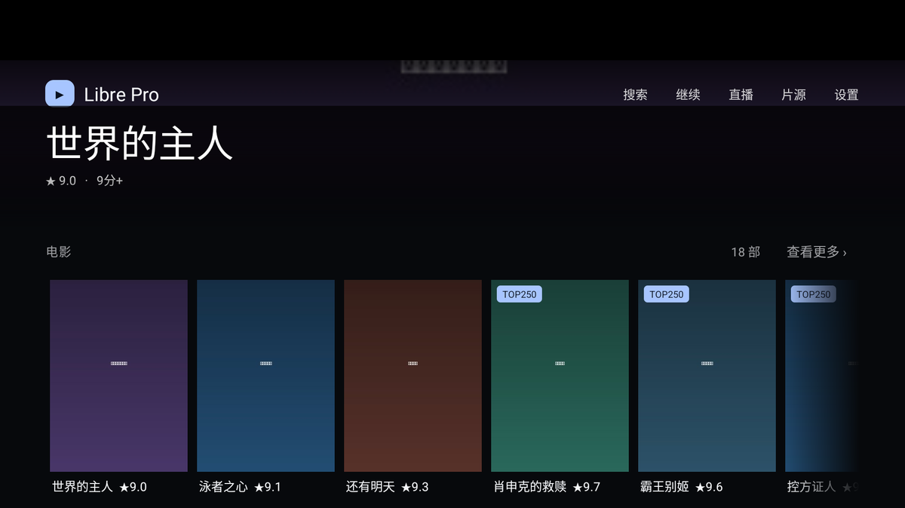
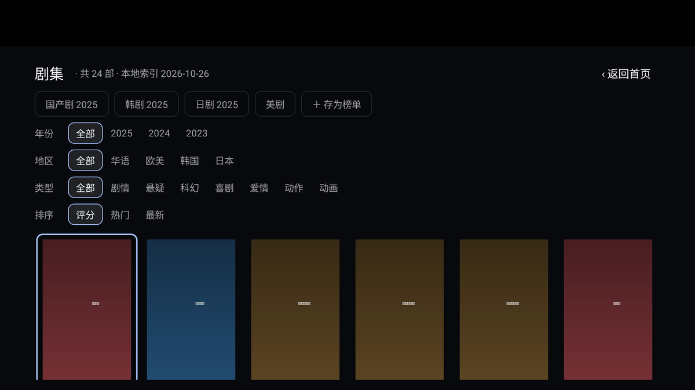
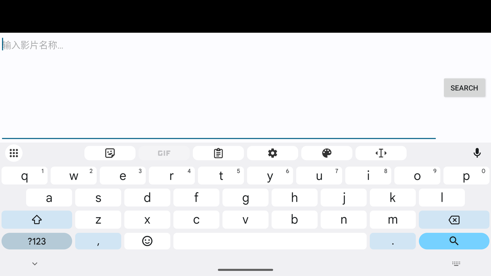
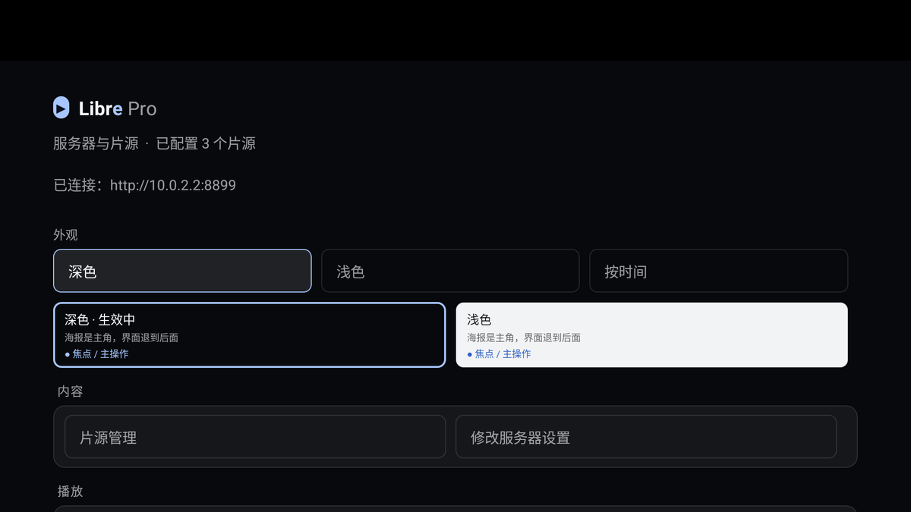

<div align="center">


# Libre Pro

**Android TV 上的原生影视客户端** —— 不为 WebView 套壳，为遥控器而生。

[](https://kotlinlang.org)
[](https://developer.android.com)
[](#)
[](#)
[](#免责声明)
[](LICENSE)

</div>

> ⚠️ **非官方分支**：本项目是 [DpadTV](https://github.com/AresCNZJ/DpadTV) 的定制分支，由个人维护，
> **与上游作者无任何隶属关系**。包名 `io.github.blackkcold.librepro`，可与原版并存安装。

---

## 它是什么

对接你自建的 [LibreTV](https://github.com/LibreSpark/LibreTV) 服务端，在电视上完成
「浏览榜单 → 搜索 → 选源 → 播放」的全流程。界面全部为 D-pad 设计：焦点环、长按菜单、
整季连播，不用找鼠标。

**这一版的重点是「少打扰」**：榜单索引打包进 APK，启动时**一次网络请求都不发**；
只有翻到底、点重试、或筛选超出本地索引范围时才去豆瓣取数据，并且带间隔与退避。

## 界面

<table>
<tr>
<td align="center"><br><sub>首页 · 榜单合并 + 片单角标</sub></td>
<td align="center"><br><sub>浏览 · 类型/年份/地区 chip + 本地索引</sub></td>
</tr>
<tr>
<td align="center"><br><sub>搜索 · 多源聚合</sub></td>
<td align="center"><br><sub>设置 · 双主题 / 片源 / 播放</sub></td>
</tr>
</table>

<sub>截图使用本地 mock 服务，地址与片源均为示例，不含任何真实配置。</sub>

## 功能

**浏览**
- 首页把多个豆瓣榜单合并去重成行，同一部片只出现一次，并标注它「为什么在这里」（TOP250 / 9分+ / 2025 / 奥斯卡）
- 内置索引：**2000+ 条**条目、47 个标签，`类型 × 年份` 的常见组合本地直接出结果
- 浏览页支持类型 / 年份 / 地区 chip，选中即筛，带「到底了」提示

**搜索**
- 多源并发聚合，按片名分组，显示来源数
- **同名不同片自动排序**：点 1957 年的《控方证人》，不会给你打开 2025 年的同名短剧（年份 / 类型 / 正片标记加权）
- 记住搜索历史，热门词一键复搜

**播放**
- Media3 / ExoPlayer，HLS 直连；硬解失败自动切下一个解码器，也可强制软解
- 续播按「播放地址」记录，与片名无关，换源也能续
- 整季作为播放列表，一集放完自动进下一集（可关）
- 倍速 0.5×–2.0×、显示比例（适应 / 裁切 / 拉伸）、进度条三段色、实时网速
- 磁盘缓存 512 MB – 4 GB 可选

**片单**
- 五态：想看 / 在看 / 看过 / 收藏 / 弃剧（再点同态＝移除）
- 主键是 `豆瓣 id` 或 `源+vodId`：**同名不同片可以共存**，同一部片从两个源加进来只有一行

**片源**
- 六种导入：手机扫码 / 粘贴文本 / 设备文件 / 网址 / 手动添加 / 服务器下发
- 一键并发测活，结果持久化，失效源标红

**取数与隐私**（与上游最大的差别）

| 场景 | 行为 |
|---|---|
| 冷启动 | **0 次**豆瓣请求，全部读内置索引 |
| 翻页 / 到底 / 重试 | 才联网，且间隔 ≥3 s（带抖动） |
| 频率上限 | 20 次 / 10 分钟 |
| 触发风控 | 指数退避 10 → 20 → 40 → 80 分钟（上限 2 h），本轮不再重试 |
| 发版包 | **不内置**服务器地址与密码，首次启动手动填写 |

## 遥控器操作

**主界面**

| 按键 | 操作 |
|---|---|
| 上下左右 | 移动焦点 |
| OK | 进入 / 执行 |
| 长按 OK | 片单菜单（想看 / 在看 / 看过 / 收藏 / 弃剧） |
| 菜单键 | 打开设置 |

**播放页**

| 按键 | 操作 |
|---|---|
| OK | 暂停 / 播放 |
| ← → | 快退 / 快进（短按 10 秒，按住连发） |
| ↑ | 倍速菜单 |
| ↓ / 菜单键 | 呼出底部操作栏 |
| 返回 | 退出播放 |

## 安装与首次配置

```bash
adb install -r LibrePro-1.3.0.apk
```

要求 Android 6.0+，任意 CPU 架构（包内没有原生库）。

1. 填服务器地址与访问密码，点「连接并登录」
2. 进「片源管理」添加采集站，或在设置里从服务器下拉配置
3. 回首页搜片名

> 片源只支持 Apple CMS **JSON** 接口（`https://.../api.php/provide/vod`），`/at/xml/` 这类 XML 通道不支持。

## 构建

凭据是否内置，由**构建类型**决定，不由命令行开关决定 —— 这样“忘了加参数”也不会把服务器地址发出去。

```bash
# JDK 17+；local.properties 只需 SDK 路径即可参与编译
echo "sdk.dir=/path/to/android-sdk" > local.properties

./gradlew :app:assembleDebug      # 自用包：注入本机地址与密码（读 local.properties），装完即连
./gradlew :app:assembleRelease    # 发行包：DEFAULT_URL / DEFAULT_PASSWORD 恒为空，且构建期自检
```

| 构建类型 | 凭据 | debuggable | 签名 | 渠道封条 |
|---|---|---|---|---|
| `debug` | 注入 `local.properties` 的值 | true | debug keystore | `seal:private` |
| `release` | **恒空**，代码里没有读取分支 | false | 专用 keystore | `seal:public` |

自用包想换地址：在 `local.properties`（**不入库**）写 `dpadtv.defaultUrl` / `dpadtv.defaultPassword`，
或命令行覆盖 `-Pdpadtv.defaultUrl=` / `-Pdpadtv.defaultPassword=`。

发行包构建会自动跑 `verifyNoSecrets`：解压 APK 扫描真实地址/密码与内网 URL 字面量，
命中任何一项直接构建失败。**唯一允许上传的产物由脚本产出**：

```bash
./tools/release.sh    # → dist/LibrePro-<ver>-public.apk + .sha256 + build-info.json
```

可选参数：`-Pdpadtv.packageId=` 换包名，`-Pdpadtv.appName=` 换桌面名称。
`-Pdpadtv.forcePrivate=true` 可让 release 包注入凭据，**仅供本机排查**，闸门会拒绝它。

### 测试

```bash
./gradlew testDebugUnitTest                        # 61 项单测
python3 tools/ui-smoke.py --serial emulator-5554   # 22 项遥控器冒烟（键盘事件驱动）
```

冒烟覆盖：冷启动 0 请求、方向键遍历不漏焦点、网格持焦、年份筛选、海报→搜索→详情、
长按片单菜单、断网降级、片单库 v4 结构、浅色/深色主题、无崩溃 / ANR。

## 数据与索引

榜单数据是**构建期快照**，脚本在 `tools/build_index.py`：

```bash
python3 tools/build_index.py --direct --enrich-years --gap 9 --max-requests 20
```

请求自带间隔与风控熔断；产出 `app/src/main/assets/douban-index.json.gz`。
新片要重新跑一次才会进本地索引，运行期不需要联网也能翻榜单。

## 已知限制

- 真机 D-pad 尚未验收（目前只有模拟器键盘事件）
- 豆瓣数据是构建期快照，新片需重新构建索引
- 换源后同一部片可能成为片单里的另一行（豆瓣 id 缺失时只能靠源身份识别）
- 片单库 v3 → v4 不可回滚，降级需清数据
- H.265 能否播取决于 SoC 硬解；直播只支持 HLS / TS / 渐进式，FLV 不支持
- 音轨切换、字幕选择尚未实现

## 名称与标识

本分支按上游「名称与标识」的要求做了三件事：**换掉应用名称、换掉图标、换掉包名**，并全程注明非官方。
`DpadTV` 的名称与图标不随 GPL-3.0 授权，因此本项目使用自己的名称（Libre Pro）、图标与包名。

## 许可

[GNU General Public License v3.0](LICENSE) —— 可自由使用、修改、分发，分发修改版须同样以 GPL-3.0 开源。

## 致谢与免责声明

- 上游：[AresCNZJ/DpadTV](https://github.com/AresCNZJ/DpadTV)（本项目的代码来源）
- 服务端：[LibreSpark/LibreTV](https://github.com/LibreSpark/LibreTV)
- 播放器：[AndroidX Media3](https://github.com/androidx/media) · 二维码：[ZXing](https://github.com/zxing/zxing)
- 榜单数据：[豆瓣](https://www.douban.com)（构建期抓取，仅存标题 / 评分 / 封面地址）

本应用**仅为聚合客户端**，不提供、不存储、不分发任何音视频内容；所有内容均来自用户自行配置的第三方接口。
请自行确认所在地法律法规与内容版权，使用者自行承担全部责任。本项目与上述上游项目、豆瓣均无隶属关系。
